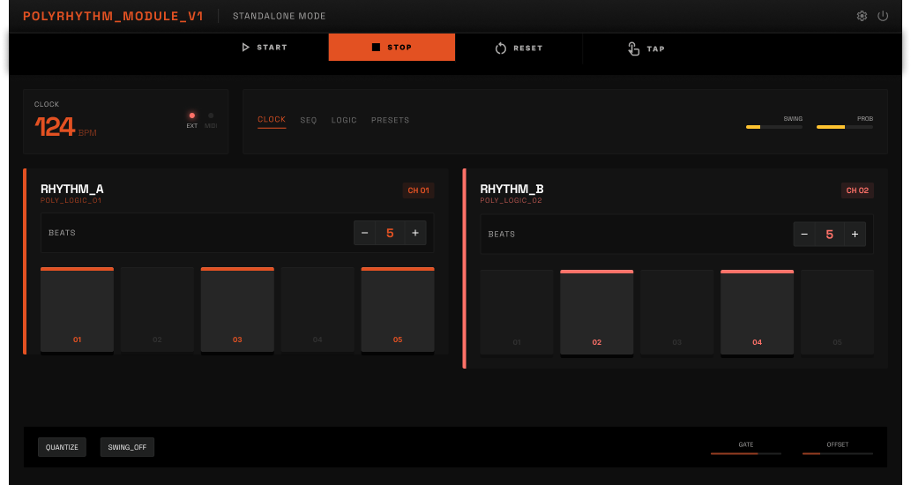

# POLYRHYTHM_MODULE_V1

A polyrhythm MIDI generator available as a **JUCE audio plugin** (AU/VST3) and a **standalone web app** — two independent rhythm tracks that play simultaneously at different beat divisions, creating layered polyrhythmic patterns.



**[Try the Web Version](https://maxwellriess.github.io/polyrhythm/)**

---

## Features

- **Two independent rhythm tracks** (RHYTHM_A / RHYTHM_B) with 1-16 beats each
- **Per-beat controls** — toggle active state, set individual MIDI notes and gate lengths
- **Global note selector** — scroll wheel / touch swipe to shift all beats on a track by semitone
- **Swing** — pushes odd-numbered beats forward for groove
- **Probability** — random chance to skip beats for generative variation
- **Gate control** — adjustable note length per track and per beat
- **Per-beat low-pass control** — sets filter brightness per step
- **Beat-fire flash animation** — visual pulse feedback when beats trigger
- **State persistence** — settings saved automatically (localStorage on web, XML in plugin)

### Web Version
- Built-in Web Audio engine with lookahead scheduling for tight timing
- **6 built-in sound types per track** — Sine, Triangle, Square, Saw, Click, and Noise
- Web MIDI output support (connect to hardware/software synths)
- Tap tempo
- Mobile-responsive layout with touch-friendly controls
- Works offline — single HTML file, no dependencies

### Plugin Version (AU/VST3)
- Two builds: a **MIDI effect** for Logic's MIDI FX slot and an **instrument** for the Instrument slot
- Syncs to DAW transport and tempo
- All parameters automatable
- Per-track MIDI channel selection (defaults: track A on channel 1, track B on channel 2)
- Resizable window — drag the corner to scale the whole interface up or down
- Optional direct MIDI output to any port (e.g. an IAC bus) for recording into a DAW track
- Optional CC74 output for the per-beat low-pass value, off by default
- macOS / Linux

Neither plugin build produces audio — both emit MIDI only, so the sound types and audio
preview exist only in the web version.

---

## Web Version

The web version is deployed via GitHub Pages from the `docs/` folder:

**https://maxwellriess.github.io/polyrhythm/**

It's a single self-contained `index.html` file with no external dependencies (besides the Google Fonts import for JetBrains Mono).

---

## Building the Plugin

### Requirements

- CMake 3.22+
- C++17 compiler (Clang, GCC, or MSVC)
- JUCE 9.0.4 (fetched automatically on first build)

### Build

```bash
cmake -B build -DCMAKE_BUILD_TYPE=Release
cmake --build build --config Release
```

Both builds auto-install to `~/Library/Audio/Plug-Ins/` on macOS. Look for **Polyrhythm_Module** in your DAW's MIDI effect list, and **Polyrhythm_Module_Inst** in its instrument list.

---

## Usage

### Quick Start

1. Set beat counts for each track (e.g., 4 vs 3 for a classic 4:3 polyrhythm)
2. Choose a sound type per track for distinct timbres (web only)
3. Adjust notes by scrolling on the NOTE selector or individual beat pads
4. Tweak gate, swing, and probability to taste
5. Hit START (web) or press play in your DAW (plugin)

### Controls

| Control | Description | Where |
|---------|-------------|-------|
| **BEATS** | Number of beats per bar (1-16) | Both |
| **NOTE** | Global note for all beats — scroll to change | Both |
| **GATE** | Note duration as fraction of beat interval | Both |
| **SWING** | Offset for odd-numbered beats (0-50%) | Both |
| **PROB** | Probability each beat fires (0-100%) | Both |
| **LPF** | Per-beat low-pass brightness | Both |
| **VEL** | Per-beat velocity | Plugin |
| **SOUND** | Preview sound type — Sine, Tri, Sqr, Saw, Click, Noise | Web |
| **CH nn** | MIDI output channel for the track — click to change | Plugin |
| **CC74** | Send the per-beat LPF value as MIDI CC74 | Plugin |
| **MIDI OUT** | Send generated MIDI to a port directly, bypassing host routing | Plugin |
| **RESET** | Restore all settings to defaults | Both |

### Keyboard Shortcuts (Web)

| Key | Action |
|-----|--------|
| `Space` | Start / Stop |

---

## The two plugin builds

| Build | AU type | Slot | Use it for |
|---|---|---|---|
| `Polyrhythm_Module` | `aumi` | MIDI FX | Driving the instrument on the same track |
| `Polyrhythm_Module_Inst` | `aumu` | Instrument | Hosts that route a plugin's MIDI output to other tracks (Ableton, Bitwig, Reaper) |

Both are built from the same sources and behave identically. The instrument build produces
no audio — it exists so the plugin can sit in the Instrument slot and be picked up as a
MIDI source by hosts that support that.

---

## Recording the generated MIDI in Logic Pro

Use the **IAC Driver**. Logic's own **Record MIDI to Track Here** does not work with this
plugin, and cannot be made to: that feature captures MIDI *played live* into the track,
and this plugin generates from the playhead with no incoming MIDI, so the capture never
triggers and you get an empty region. The same limitation is reported for other MIDI FX
generators. Logic also offers no way to route an instrument plugin's MIDI output to a
track, so the instrument build is no help here either.

1. Open **Audio MIDI Setup** → **Window** → **Show MIDI Studio**, double-click **IAC
   Driver** and tick *Device is online*.
2. In the plugin header, click **MIDI OUT** and pick the IAC bus.
3. Make a **separate** track whose input is that IAC bus, arm it, and record.

Costs a little timing jitter through the IAC bus. Leave **CC74** off while recording unless
you actually want filter data written into the region.

**Do not arm the track the plugin itself is on while the IAC bus is selected.** Logic feeds
every armed track from all MIDI inputs, so the IAC bus would come back into the plugin's own
input. Only generated notes are sent to the port — pass-through input never is, specifically
so this cannot loop — but the instrument on that track would still receive every note twice,
once through the plugin chain and once from the IAC bus, which sounds like doubling or
distortion. Record on a separate track.

---

## Project Structure

```
polyrhythm/
  Source/
    PluginProcessor.h/.cpp   -- MIDI sequencer engine (JUCE)
    PluginEditor.h/.cpp      -- Plugin UI (JUCE)
  Tests/
    SchedulerTest.cpp        -- Beat scheduler regression tests
    EditorSnapshot.cpp       -- Renders the UI offscreen at several sizes
  docs/
    index.html               -- Standalone web version
  CMakeLists.txt             -- Build configuration
```

---

## License

All rights reserved.
